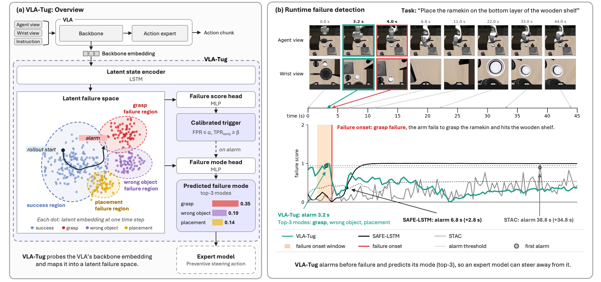

# Failure Prediction and Classification in Vision-Language-Action Models Via Calibrated Latent Probing

[](https://vla-tug.github.io)


Official code for **VLA-Tug**, a lightweight probe on the latent layers of a Vision-Language-Action (VLA) model that predicts a failure **before it happens**, predicts its **mode**, and comes with **calibrated error guarantees**. See the [project page](https://vla-tug.github.io) for the dataset, prompts and demos.

<p align="center">
  <a href="docs/assets/vla_tug_overview.png"></a>
</p>

## Overview 🗺️

The pipeline has four stages:

1. **Pool** the backbone embedding of every policy step: the mean over the agent-image, wrist-image and language tokens, a 6144-d vector per step.
2. **Train** a probe on the steps that precede a failure: an LSTM over the embeddings with a failure-score head, a failure-mode head and a semantic (CLIP) head.
3. **Calibrate** the alarm threshold on held-out rollouts, with max-conformal prediction or with Learn-then-Test, which bounds the false-positive rate (FPR) and the early true-positive rate (TPR early) together.
4. **Evaluate** against annotated failure times: the area under TPR early vs. FPR up to FPR = 40%, where TPR early counts an alarm at or before the failure onset.

**Important note:** the real-robot data is not released; all other results can be reproduced from the released simulated datasets. Code taken from other projects is listed in [`NOTICE`](NOTICE).

#### What's included? 🗂️❓

- **Probe:** the LSTM probe with its three heads and the four label variants (`onset_pre`, `onset_traj`, `onset`, `onset_post`) in `fp/models` and `fp/train`.
- **Calibration:** SAFE's functional conformal band, max-conformal prediction and Learn-then-Test, with the PPV bound, in `fp/calibration`.
- **Baselines:** SAFE-MLP and SAFE-LSTM, Mahalanobis, Euclidean (k-NN) and PCA-KMeans, STAC, ActProbe and FailureSpot, in `fp/baselines`.
- **Evaluation:** the metrics, splits (new-task, new-signature and new-skill on LIBERO-X, leave-three-out on LIBERO-10, leave-one-out on the real robot) and the paper's tables and figures, in `fp/metrics`, `fp/data` and `fp/eval`.
- **Datasets:** pooled embeddings and annotations of 3,180 simulated rollouts of two VLAs (GR00T-N1.7 and pi0.5) on LIBERO-10 with occlusions and on LIBERO-X.

## Getting Started 🏁

Tested with Python 3.11 and PyTorch 2.7.1.

### Installation 🛠️

```bash
pip install -e ".[dev]"          # the library, the command line tools and pytest
pip install -e ".[targets]"      # only to rebuild the CLIP targets from labels (transformers)
```

### Tests ✅

```bash
pytest                           # synthetic data, no download needed
```

Where the code is a port of SAFE, the tests also compare it with SAFE's own code if a checkout is available (`SAFE_ROOT=/path/to/SAFE pytest`). If unrelated pytest plugins are installed system-wide, run `PYTEST_DISABLE_PLUGIN_AUTOLOAD=1 pytest`.

## Reproducing Results 🖥️

### Download Datasets 📁

```bash
python -m cli.download liberox_groot     # or libero10_groot, libero10_pi05
```

This fetches the pooled features, the probe targets, the manifest and (LIBERO-X) the split files into `data/<dataset>/`. The datasets and their Hub ids are listed in `fp/config.py`; the format of each file is in [`data/README.md`](data/README.md). STAC, ActProbe and FailureSpot also read the sampled action chunks, which are extracted from the raw rollouts of the dataset (`python -m cli.prepare_actions <dataset> <rollout folder>`).

### Train Probes and Baselines 🏋️

```bash
python -m cli.train --datasets liberox_groot                        # probe grid, every split; resumable
python -m cli.run_baselines --datasets liberox_groot                # distance baselines; add --families safe_mlp safe_lstm ...
python -m cli.evaluate --datasets liberox_groot                     # calibrate and sweep alpha on every saved run
```

**Details.** Every run is written to `results/<dataset>/<split>/<method>/` (scores, weights, history). Several workers can share a sweep with `--worker I/N`; `--dry-run` lists what would run. The launch scripts used for the full sweeps are in [`scripts/`](scripts).

### Tables and Figures 📊

```bash
python -m cli.figures                                    # main table, ablations, mode tables, curve figures
python -m cli.ltt_table --delta 0.1 --n-starts 40        # Learn-then-Test against max-conformal and functional conformal
python -m cli.onset_shift                                # sensitivity to the failure time
python -m cli.latency                                    # online latency of every method
```

**Details.** Everything is read from the saved runs; no model is run and nothing is retrained. The compared configurations are always chosen on validation episodes, never on unseen tasks.

## Citation 🏷️

Citation information will be added after the review. Code is released under the MIT licence (`LICENSE`); documentation, published features and results under CC BY 4.0 (`LICENSE-DATA-CC-BY-4.0.txt`); code ported from other projects keeps its own licence, listed in [`NOTICE`](NOTICE).
